  

  

  
  
  
  

 

### About

  

### Stack

  
   
  

### Activity

  

  

  <picture>
    <source media="(prefers-color-scheme: dark)" srcset="https://raw.githubusercontent.com/copylee711/copylee711/output/github-contribution-grid-snake-dark.svg"/>
    <source media="(prefers-color-scheme: light)" srcset="https://raw.githubusercontent.com/copylee711/copylee711/output/github-contribution-grid-snake.svg"/>
    
  </picture>

  Thanks for stopping by.

