<!-- 由 .github/scripts/build_assets.py 生成 assets/ 下的 SVG；统计卡片和贪吃蛇由 Action 写入 output 分支 -->

  <picture>
    <source media="(prefers-color-scheme: dark)" srcset="https://raw.githubusercontent.com/copylee711/copylee711/main/assets/header-dark.svg"/>
    
  </picture>

  

  <a href="https://github.com/copylee711"><picture>
    <source media="(prefers-color-scheme: dark)" srcset="https://komarev.com/ghpvc/?username=copylee711&label=VIEWS&style=flat-square&color=2b2d31"/>
    
  </picture></a>
  <a href="https://github.com/copylee711?tab=followers"><picture>
    <source media="(prefers-color-scheme: dark)" srcset="https://img.shields.io/github/followers/copylee711?label=FOLLOWERS&style=flat-square&color=2b2d31&labelColor=0a0a0b&logo=github&logoColor=8a9099"/>
    
  </picture></a>
  <a href="https://copylee.cn"><picture>
    <source media="(prefers-color-scheme: dark)" srcset="https://img.shields.io/badge/COPYLEE.CN-2b2d31?style=flat-square&labelColor=0a0a0b&logo=googlechrome&logoColor=8a9099"/>
    
  </picture></a>
  <a href="https://github.com/copylee711?tab=repositories"><picture>
    <source media="(prefers-color-scheme: dark)" srcset="https://img.shields.io/github/stars/copylee711?label=STARS&style=flat-square&color=2b2d31&labelColor=0a0a0b&logo=github&logoColor=8a9099"/>
    
  </picture></a>

 

  <picture>
    <source media="(prefers-color-scheme: dark)" srcset="https://raw.githubusercontent.com/copylee711/copylee711/main/assets/title-about-dark.svg"/>
    
  </picture>

  <picture>
    <source media="(prefers-color-scheme: dark)" srcset="https://raw.githubusercontent.com/copylee711/copylee711/main/assets/terminal-dark.svg"/>
    
  </picture>

 

  <picture>
    <source media="(prefers-color-scheme: dark)" srcset="https://raw.githubusercontent.com/copylee711/copylee711/main/assets/title-stack-dark.svg"/>
    
  </picture>

  <picture>
    <source media="(prefers-color-scheme: dark)" srcset="https://skillicons.dev/icons?i=ts,js,vue,python,kotlin,cs,nodejs,vite&theme=dark&perline=8"/>
    
  </picture>
   
  <picture>
    <source media="(prefers-color-scheme: dark)" srcset="https://skillicons.dev/icons?i=tauri,androidstudio,dotnet,git,github,vscode,idea,windows&theme=dark&perline=8"/>
    
  </picture>

 

  <picture>
    <source media="(prefers-color-scheme: dark)" srcset="https://raw.githubusercontent.com/copylee711/copylee711/main/assets/title-activity-dark.svg"/>
    
  </picture>

  <picture>
    <source media="(prefers-color-scheme: dark)" srcset="https://raw.githubusercontent.com/copylee711/copylee711/output/stats-dark.svg"/>
    
  </picture>

  <picture>
    <source media="(prefers-color-scheme: dark)" srcset="https://streak-stats.demolab.com?user=copylee711&hide_border=true&background=0A0A0B&stroke=2B2D31&ring=C9CCD2&fire=8A9099&currStreakNum=E4E6EA&sideNums=E4E6EA&currStreakLabel=C9CCD2&sideLabels=8A9099&dates=5C6370"/>
    
  </picture>

  <picture>
    <source media="(prefers-color-scheme: dark)" srcset="https://raw.githubusercontent.com/copylee711/copylee711/output/github-contribution-grid-snake-dark.svg"/>
    
  </picture>

  <picture>
    <source media="(prefers-color-scheme: dark)" srcset="https://raw.githubusercontent.com/copylee711/copylee711/main/assets/divider-dark.svg"/>
    
  </picture>

  Thanks for stopping by.

